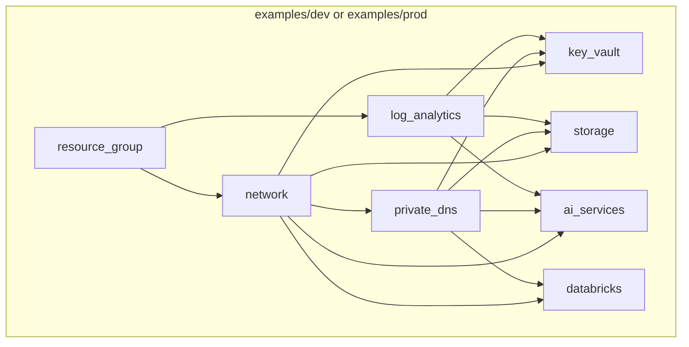

# terraform-azure-ai-platform

Terraform modules that assemble a compact Azure AI and data platform: a resource group, a virtual network prepared for Databricks VNet injection, Key Vault, Azure Data Lake Storage Gen2, Azure OpenAI, an Azure Databricks workspace, and a Log Analytics workspace.

This is a reference implementation. It is ready to `plan` after you copy an example `terraform.tfvars` and set a real subscription ID. It is not a full enterprise landing zone; see [cloud-ai-architecture-portfolio](https://github.com/rajeshrajput97/cloud-ai-architecture-portfolio) for the broader design.

[](https://github.com/rajeshrajput97/terraform-azure-ai-platform/actions/workflows/terraform.yml)

## Architecture



Private endpoints are created for Key Vault, ADLS (blob and dfs), and Azure OpenAI in both examples. The production example also places the Databricks workspace front end behind a private endpoint and turns off public network access. Cluster nodes use VNet injection with no public IP in both environments.

## Modules

| Module | Purpose |
| --- | --- |
| [modules/resource_group](modules/resource_group) | Tagged resource group |
| [modules/network](modules/network) | Virtual network, Databricks delegated subnets, private-endpoint subnet, NSGs |
| [modules/private_dns](modules/private_dns) | Private DNS zones for Key Vault, ADLS, OpenAI, and Databricks |
| [modules/log_analytics](modules/log_analytics) | Central Log Analytics workspace |
| [modules/key_vault](modules/key_vault) | Key Vault with Azure RBAC, optional private endpoint and diagnostics |
| [modules/storage](modules/storage) | ADLS Gen2 account with bronze/silver/gold containers |
| [modules/ai_services](modules/ai_services) | Azure OpenAI account, optional chat/embedding deployments |
| [modules/databricks](modules/databricks) | Databricks workspace with VNet injection |

## Examples

- [examples/dev](examples/dev) — shorter retention, LRS storage, no Key Vault purge protection, public Databricks UI for easier non-production access.
- [examples/prod](examples/prod) — 90-day retention, zone-redundant storage, purge protection, private Databricks UI.

```bash
cd examples/dev
cp terraform.tfvars.example terraform.tfvars
# Set subscription_id and a unique_suffix that will not collide globally
terraform init
terraform plan
```

Azure OpenAI is not available in every region and often requires prior quota approval. Adjust `location` and model deployment names to match what your subscription can host. This repository does not apply changes for you.

## Quality checks

GitHub Actions runs the following on every push and pull request:

```bash
terraform fmt -check -recursive
# then, for each module and example:
terraform init -backend=false
terraform validate
tflint
```

## License

MIT © 2026 Rajesh Kumar Rajput
